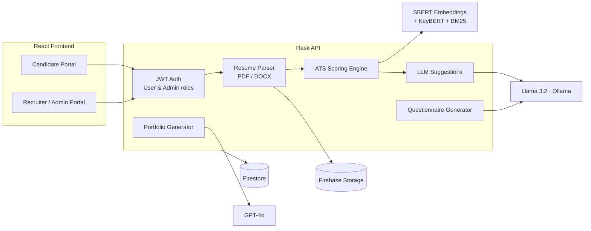
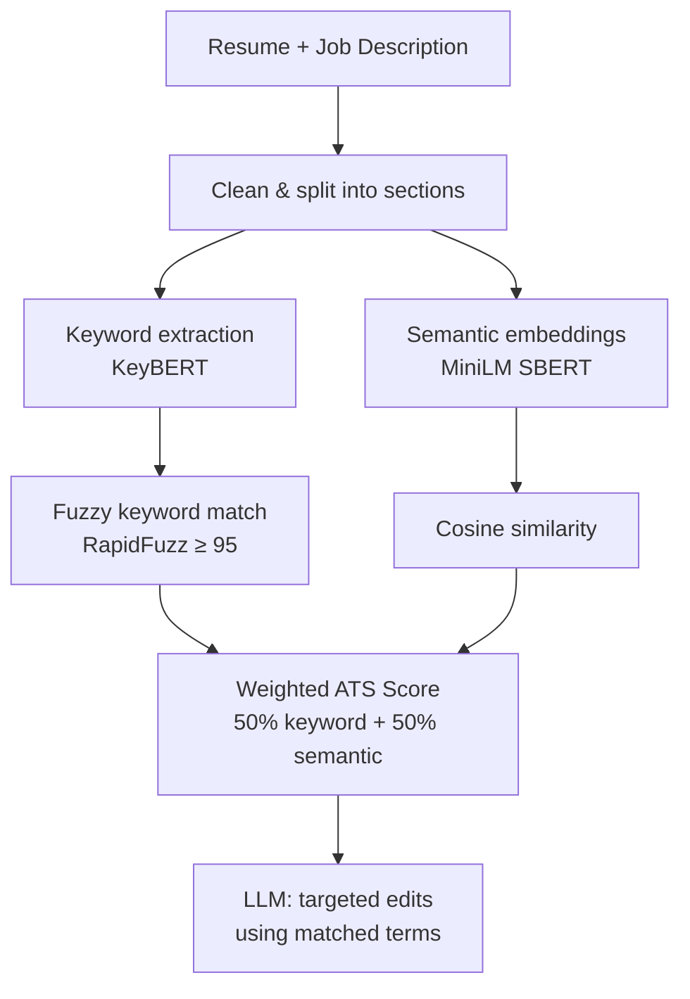

# AI Resume Analyser & Enhancer

> AI-powered recruitment platform. Candidates get an **ATS score**, keyword gap analysis, and **LLM-generated resume improvements** for a specific job. Recruiters post jobs and review ranked applications.

📄 **Published at [CLiC-it 2025](https://aclanthology.org/2025.clicit-1.51/)** (Italian Conference on Computational Linguistics) · [Paper PDF](https://ceur-ws.org/Vol-4112/50_main_long.pdf)

🔒 *Source code is private. A demo is available on request.*

<!-- Add demo video / screenshots -->

---

## 🛠 Tech Stack

| Layer | Technologies |
|---|---|
| **Frontend** | React · React Router · Tailwind CSS · Radix UI · Axios |
| **Backend** | Python · Flask · JWT auth |
| **NLP / ML** | Sentence-Transformers (MiniLM) · KeyBERT · BM25 · RapidFuzz · scikit-learn (cosine similarity) |
| **LLMs** | Llama 3.2 (local via Ollama) · OpenAI GPT-4o |
| **Parsing** | pdfplumber · pdfminer · python-docx |
| **Data & Cloud** | Firebase Firestore · Firebase Storage · Google Sheets API (request logging) |

## 🏗 Architecture

## ✨ Key Features

**For Candidates**
- Upload a resume (PDF/DOCX) and apply to posted jobs
- **Hybrid ATS score**: keyword match (KeyBERT + fuzzy matching) combined with **semantic similarity** (Sentence-BERT embeddings)
- **Matching vs. missing keywords** for the target job
- **Section-wise improvement suggestions** generated by an LLM
- **Job-specific screening questionnaires** generated from the recruiter's focus topics
- **One-click portfolio website** generated from the resume (GPT-4o)

**For Recruiters**
- Post jobs with required skills and questionnaire focus areas
- View all applications per job with scores and analysis
- Securely access candidate resumes

## 🧠 Scoring Pipeline

## 📄 Publication
**AI-Driven Resume Analysis and Enhancement Using Semantic Modeling and Large Language Feedback Loops**
*Proceedings of the Eleventh Italian Conference on Computational Linguistics (CLiC-it 2025)*, Cagliari, Italy, pp. 526–538.

🔗 [ACL Anthology](https://aclanthology.org/2025.clicit-1.51/) · [PDF (CEUR-WS)](https://ceur-ws.org/Vol-4112/50_main_long.pdf)

## 🔬 Fairness Evaluation
A built-in test harness checks that LLM-generated resume improvements **don't fabricate skills**:
- Batch-processed resumes against a target job and compared ATS scores before and after enhancement
- Each new term the LLM introduced was **justified against the original resume** with sentence-embedding similarity
- Computed a **fairness/justification percentage** per resume, flagging enhancements that add unsupported keywords
- Compared the **local Llama 3.2** pipeline against **GPT-4o**, with results exported to Excel for analysis

<!-- SCREENSHOTS: upload images to assets/ then delete this comment line and the closing one below
## 📸 Screenshots
| Candidate Dashboard | ATS Analysis | Recruiter View |
|---|---|---|
|  |  |  |
-->

## 💡 Highlights
- Combined classic IR (BM25, TF-IDF) with transformer embeddings for more robust matching than plain keyword ATS
- Runs the main LLM tasks **locally (Ollama)** for privacy and cost, with GPT-4o for generation-heavy tasks
- Role-based access (candidate vs. recruiter) with JWT
- Bias-term detection in resume text

---
📫 *Happy to walk through the system in an interview.*
